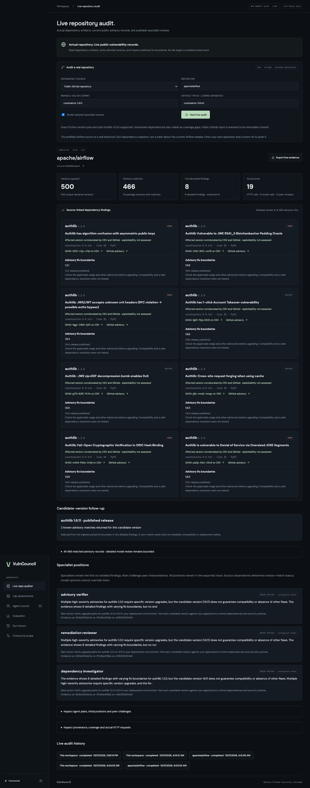

# VulnCouncil

**Independent specialists. Shared evidence. Deterministic adjudication.**

A collective security review app for the UCSC AI Hackathon, Cisco Outshift / AGNTCY track. The **Live repo auditor** reads actual Python/npm dependency artifacts, queries OSV and GitHub advisory records, checks published fix boundaries, and runs three specialist reviews and peer challenges over real SLIM. Findings link to immutable repository commits and public source records. Version matches, deployment reachability and exploitability remain distinct.

The original six-specialist local lab is also available for controlled tests of the deterministic evidence protocol. Lab scenarios and their benchmark are separate from real repository audits. No repository code is installed or executed by the auditor.



## Start

Docker Desktop must be running. The complete container stack builds its own frontend and backend:

```sh
docker compose --profile full up --build -d
```

Open **http://127.0.0.1:8000**. Startup launches the SLIM dataplane, local lab, API, six lab specialist workers and three live audit workers. First build downloads the pinned SDK and its upstream dependencies. Inspect readiness with `docker compose --profile full ps` and logs with `docker compose logs api`.

For development on the host, use Python 3.12+, Node 22.12+ (verified with Node 24), `uv`, and Docker:

```sh
make setup
make demo
```

`make demo` builds React, starts the Docker fixture and SLIM, and serves the dashboard through FastAPI on port 8000. Use **one startup path at a time** to avoid the port conflict. Ctrl+C stops the host API and workers; `make down` stops Docker services. Container runs persist data in `vulncouncil_vulncouncil-data`; host runs persist under `data/`.

Optional host configuration:

```sh
cp .env.example .env
```

The default is **real SLIM**. A connection failure stops startup; it never silently falls back to memory. No model API key is needed for the default demo.

## Test and evaluate

```sh
make test
make evaluate
```

Unit and end-to-end tests use the named fixture through its actual FastAPI handlers, with an explicitly labeled memory transport. They cover origin/route/method/permission restrictions, budgets, deadlines, stop behavior, independent observations, duplicate evidence, counterexamples, persistence, full scenarios, A2A cards, and optional model response validation. `make evaluate` writes measured results to `docs/evaluation-results.json`.

With a real SLIM demo running, verify live acceptance checks:

```sh
.venv/bin/python scripts/verify_live.py
```

This checks the dashboard HTTP response and all three core scenarios plus a safety stop, and saves the actual runs and events to `docs/live-verification.json`. It requires every successful run to have real peer receipts, challenges, counterevidence, belief updates, and the expected deterministic verdict. The dashboard's 13-case benchmark is clearly labeled **memory test transport**; real SLIM acceptance is recorded separately.

For laptop debugging without Docker, first stop the Docker services, then:

```sh
make memory
```

This starts a host fixture and a **MEMORY · TEST MODE** API. It is a debugging mode, not the real AGNTCY judging path.

## Live repository auditor

Open **Live repo auditor**. Audit this workspace or enter a public GitHub repository, ref and supported dependency artifact paths. The prefilled Airflow source is a genuine historical snapshot, labeled as such; change the ref to audit your intended version. No findings are predetermined.

```sh
.venv/bin/python scripts/verify_repository_audit.py
```

This validates actual public APIs and SLIM reviews for the workspace and historical public artifact. Inspect `docs/repository-audit-verification.json`, including its `validated` field, to see executed results. The executed workspace audit found a real NLTK dependency advisory match; see [the actual maintainer case](docs/real-audit-case.md). See [the real workflow and its limits](docs/live-repository-audit.md) and [the judging script](docs/demo-script.md).

## Executable customer-isolation case

Select **Billing portal · patch during incident** for the main judging demonstration. A Northstar user retrieves Harbor Robotics’ invoice through a real authenticated API missing tenant authorization. The council compares owner, colleague and outsider HTTP responses, independently tests a second invoice, switches to the corrected demo deployment, and preserves the earlier exposure as `DISPUTED`. The corrected-only run returns `NOT_REPRODUCED` while legitimate colleague access continues working.

All companies and records are fictional. These outcomes come from actual invoice HTTP responses, not preset fixture results. Every individual HTTP call is counted by the gateway. The toggle selects a corrected demo deployment; it does not deploy a production patch. See [the billing case and direct reproduction commands](docs/billing-use-case.md).

```sh
.venv/bin/python scripts/verify_billing.py
```

This verifies direct HTTP controls and all three council outcomes over real SLIM, saving actual evidence and model metrics to `docs/billing-verification.json`. The 13-case authored benchmark is separate.

## Additional demonstrations

1. Select **Ambiguous injection** and start. The injection agent advocates investigating a parser-like signal. The skeptic obtains the same signal from a benign control and a failed causal reproduction. Confidence drops from 78% to 12%; the resolver returns `NOT_REPRODUCED`.
2. Select **Broken access control** with the guard off. The access specialist observes synthetic Alice accessing synthetic Bob's fixture record. The skeptic independently repeats the named check; the risk specialist supports a bounded authorization fix. The protocol returns `CONFIRMED`.
3. Select **Patch & reassess** or enable the guard on the access scenario. The same check now denies access. Rule mode reuses the previous completed confidence as a prior; model mode evaluates current evidence and distinguishes historical observations. The protocol returns `NOT_REPRODUCED`.
4. Select **Surprise · guard changes mid-run**. The initial access observation is followed by an enabled guard, fresh negative checks, and a specialist request for guard-configuration expertise. Three initial participants become four; the resolver retains the conflicting history as `DISPUTED`. You can also toggle the guard during an active access assessment before final voting.
5. Open **Evaluation** to inspect 13 distinct conditions, development/holdout scores, separately executed baselines, request counts, elapsed time, and uncertainty intervals. Open **Scope boundary** to show a blocked named check and `NEEDS_HUMAN`.

See [the 3-minute demo script](docs/demo-script.md).

## What is implemented

- Six available specialists with different objectives, permissions, SLIM addresses and peer mailboxes. Initially select the relevant specialist, verifier and risk assessor; recruit additional capabilities when requested.
- Real App SDK 0.5.5 / A2A group communication through SLIM 1.0.0. All phase commands, agent packets, and resolution bookkeeping traverse group sessions. Peer response packets are observed without being echoed into endless loops.
- FastAPI, validated Pydantic contracts, a shared fail-closed tool gateway, versioned per-run patch state and live interventions, request limits, a deadline, and a stop switch.
- Deterministic `CONFIRMED`, `LIKELY`, `DISPUTED`, `NOT_REPRODUCED`, and `NEEDS_HUMAN` evidence rules. Only matched gateway observations can count as evidence.
- SQLite run snapshots with reasoning/model attribution and immutable event rows, including selected capabilities, evidence, votes, revisions, metrics, and errors.
- React/Vite dashboard, live SSE events with reconnection cursors, evidence detail, dissent, baseline comparison, history, JSON export, dark/light themes, and responsive layout.
- Local OASF-shaped capability manifests, per-agent A2A cards, and capability-based selection. **This is a local registry, not a deployed AGNTCY Directory.**
- OpenTelemetry spans for tools, group exchange, specialist execution, and adjudication. The durable timeline works without a collector. An optional OTLP HTTP collector can be configured.
- Optional model-directed plans, approved check execution, hypotheses, challenges, belief revisions and final positions. No rule-based vote or expected fixture label anchors the model. Evidence references and tool permissions are validated before use. The deterministic resolver remains authoritative. Real SLIM acceptance uses the default rule policies; model validation is recorded separately.

Implementation verification and optional components are listed in [docs/implementation-status.md](docs/implementation-status.md).

## Measured results

The revised benchmark executes **39 assessments across 13 distinct synthetic conditions**, with seven development and six reserved stress cases. Single-agent and independent-majority baselines use the same specialist implementations and permissions, with all phases and their own evidence. The council makes additional checks and applies evidence adjudication. Results include per-mode resources, separate stress-case scores, and 95% case-level accuracy intervals; they do not establish real-world superiority.

All three rule-mode processes achieved 100% precision and recall on adjudicable positive/benign cases. Each baseline additionally confirmed one case whose evidence required abstention; the council made no such unsupported confirmation. Unknown truth is scored separately from benign false positives. Correct abstentions were 6/7, 3/7 and 7/7 respectively. Tool requests were 27, 42 and 43. Even the council’s perfect 13-case exact accuracy has a 95% interval of approximately 77–100%, and the cases remain authored synthetic tests.
See [evaluation methodology and limitations](docs/evaluation.md), [machine-readable results](docs/evaluation-results.json), and [rule transport evidence](docs/live-verification.json), and [real model + SLIM evidence](docs/model-slim-verification.json).

## Optional model mode

Set all of these in `.env` for host mode:

```dotenv
AGENT_REASONING=llm
LLM_API_KEY=your-provider-key
LLM_BASE_URL=https://your-chat-completions-provider/v1
LLM_MODEL=your-model-id
```

Models choose useful approved checks before forming positions; the risk assessor reads evidence only. Planning is bounded to two checks and two capability requests per planning phase. Models receive tool contracts, and the protocol requires an initial observation and fresh checks after an environment change; the model chooses the approved checks. Challenge plans produce the actual checks; review forms the position. Final voting reuses that model position only if both the observed evidence set and environment version are unchanged. Model prompts include objectives, tool contracts, sanitized observations, the specialist’s own prior positions and untrusted peer claims. Current observations and historical evidence are separated when forming a position; probability_issue_true describes the current claim rather than confidence in a rejection. They exclude scenario IDs, expected labels, fixture variants and deterministic policy votes. Provider errors, unauthorized plans and invented references fail explicitly. The default remains the verified no-key rule mode.

```sh
# Local Qwen model; real inference, no paid API
ollama pull qwen3:4b
.venv/bin/python scripts/validate_model.py --local --local-model qwen3:4b
# Configured hosted provider from .env
.venv/bin/python scripts/validate_model.py
# Explicitly opt into the much larger model benchmark
.venv/bin/python scripts/validate_model.py --benchmark
```

`make model` launches the Docker API with `docker-compose.model.yml`: native local Ollama at `host.docker.internal:11434`, Qwen3 4B and live SLIM. It requires the local model server to be running. The assessment banner must show **MODEL REASONING**. Historical runs retain their own reasoning attribution; benchmark results identify rule/model mode separately. The workspace opens an active assessment or the latest completed one, while interrupted runs remain in History. The ordinary `docker compose --profile full up -d` path retains rule reasoning. Stop/recreate the API when switching modes; the model overlay never silently falls back to rules.

The script writes actual outcomes to `docs/model-verification.json`; inspect `validated`, transport, errors, plans and evidence before claiming success. A successful mock test is not real-provider validation. Native Ollama is supported with `LLM_PROVIDER=ollama`, `LLM_BASE_URL=http://127.0.0.1:11434/v1`, `LLM_MODEL=qwen3:4b` and a nonempty local placeholder key. For Docker, use `http://host.docker.internal:11434/v1` and ensure the server is reachable from Docker. The 120-second assessment deadline still applies. On this laptop, recorded Qwen3 4B core runs took roughly 69–81 seconds on the memory bus and 85–98 seconds over SLIM; 8B attempts often timed out. Plan the live judging demonstration around one model assessment, and use the recorded traces for additional examples. Default dashboard evaluation disables model calls; `/api/evaluation?use_model=true` explicitly enables them only when llm mode is configured.

Live AGNTCY Directory, AGNTCY Identity service, an external telemetry dashboard, and general-purpose security scanning are not part of this implementation. SLIM uses a shared secret for local identities; this is not a production authentication deployment. Directory and Identity are stretch integrations with documented boundaries.

## Architecture and files

```text
app/                 API, run facilitator, safety, resolver, SQLite, telemetry
app/transports/      real SLIM/A2A and explicit memory test bus
agents/              six specialists, independent workers, optional reasoning
tools/               scoped named-check gateway and fixture client
lab_target/          synthetic finite fixture and container
schemas/             Pydantic contracts
config/              capabilities, safety, adjudication, scenarios, SLIM
frontend/            React + TypeScript + Vite dashboard
tests/               no-key unit and end-to-end coverage
scripts/             offline evaluation, live acceptance, memory startup
docs/                architecture, demo, results, screenshots, verified status
```

See [architecture](docs/architecture.md). Agent cards are available at `/api/agents/{agent_id}/.well-known/agent-card.json`; manifests at `/api/agents/manifests`; interactive API documentation at `/docs`.

## Troubleshooting

| Symptom | Action |
| --- | --- |
| Port 8000 already in use | Stop the host API before starting the full Docker profile, or stop the container API before `make demo`. |
| Worker startup timeout | Confirm SLIM is running on 46357; inspect `data/workers/*.log` on the host or `/app/data/workers/` in the API container. All participants must use the same shared secret. |
| Fixture connection error | Confirm `docker compose ps` reports a healthy lab; check `http://127.0.0.1:8001/health`. |
| Dashboard route is missing | Run `make build` before starting the host API. The production app serves `frontend/dist`. |
| UI shows memory mode | Stop the debugger and start the SLIM demo. The transport banner always reflects the actual mode. |
| Dependency download fails | Allow dependency registry access during setup. Default assessments require only local services after installation. |
| Interrupted assessment after restart | The run is marked failed rather than pretending to resume a lost group session. Start a new run. |
| Model planning or vote errors | Verify your endpoint supports JSON chat completions and that the configured model is available. Keep `AGENT_REASONING=rules` for the verified no-key path. |

The lab uses a dedicated Docker bridge and loopback-only published ports. It is not an OS network sandbox: the application gateway enforces allowed origins and named tools. Keep the demo bound to localhost. The frontend uses system font fallbacks if optional Google Fonts are unavailable.

## Upstream references

Integration APIs were verified against [AGNTCY App SDK](https://github.com/agntcy/app-sdk), its group chat tests, and [CoffeeAGNTCY Lungo](https://github.com/agntcy/coffeeAgntcy/tree/main/coffeeAGNTCY/coffee_agents/lungo). Documentation: [AGNTCY](https://docs.agntcy.org/). Local reference clones under `.reference/` are ignored and are not application source. The supplied build spec and Cisco track PDF remain unchanged.

