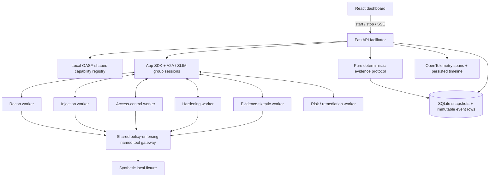

# Architecture

## Process and communication boundaries

In real SLIM mode, FastAPI launches six independent Python worker processes. Each owns a specialist instance, its own SLIM identity (`vulncouncil/agents/{agent_id}`), and per-run peer mailboxes. App SDK 0.5.5 stores its SLIM app in process-global state, which makes separate processes necessary for independent addresses. The facilitator has a seventh SLIM identity.

The verified SDK `start_streaming_groupchat` method creates a shared group session for each bounded phase. Commands use validated A2A `SendMessageRequest` messages; workers respond using `SendMessageResponse` envelopes containing validated `AgentPacket` payloads. Responses go to the entire group. Workers recognize peer packets and retain them without echoing them. The facilitator awaits every selected agent and closes the session explicitly. Phases are observe/open, discover, challenge, review, final vote, resolution broadcast, and completion broadcast. Responses are not prerecorded or synthesized by the facilitator.

Each specialist has separate code, an objective, tool permissions, a system policy, and decision logic. Decisions are derived from named fixture observations. The same finite fixture result would change agents' positions if the authorization/header guard changes or evidence becomes incomplete. The default implementation is deterministic policy reasoning; optional model mode chooses bounded check plans, hypotheses, challenges, revisions and final votes without a deterministic vote anchor. It is not an unrestricted autonomous security agent.

The facilitator only selects capabilities, sends phase commands, persists events, enforces deadlines, and invokes pure resolution. It does not write specialist claims, invent evidence, or impose a final opinion. Belief revision shows the probability assigned to the original hypothesis; a rejection vote can have a low probability that the hypothesis is true.

## Shared gateway

Workers cannot fetch arbitrary targets. They call an authenticated internal endpoint with a run ID, worker identity, and named check. Each worker receives a distinct random gateway key through its environment. The API binds that key to the worker's identity, preventing another specialist's permissions from being claimed. Keys are never included in evidence or browser configuration. The API checks current run state, exact scheme/hostname/port origin, route, method, named check, specialist permissions, total budget, per-agent budget, and deadline. It blocks redirects and environment proxy use.

Tool outputs have an allowed scalar fact schema. The gateway produces observation IDs, sanitized snippets, response hashes, and reproducibility metadata. The facilitator verifies each returned observation against the actual gateway record before allowing it to count as evidence. A decisive benign-control counterexample must match the original signal. Evidence IDs cannot be copied into extra independent observations. Two equal response hashes are valid independent repetitions when they were collected separately by different observers; copying one observation is not independent evidence.

Global stop, unknown checks, and policy violations stop further tool execution. Findings become `NEEDS_HUMAN` regardless of the vote tally. Runs have at most two deliberation rounds and a 120-second deadline. They become terminal only after the final event is durable, avoiding an SSE finalization race. A server restart marks interrupted runs failed; sessions are not fabricated as resumed.

## Deterministic resolution

The resolver in `app/deliberation.py` consumes finding evidence and the latest vote from each agent. Its configuration is in `config/deliberation.yaml`. Safety takes precedence. Credible positives plus negative direct evidence preserve `DISPUTED`; failed reproduction or a decisive benign control without direct positives produces `NOT_REPRODUCED`; two supporters and two independent repeatable positive observations allow `CONFIRMED`; missing independent reproduction gives `LIKELY`; incomplete facts require human review. Every final finding records the exact rule used.

## Data and observability

SQLite stores complete validated run snapshots, including selected agents, findings, evidence, votes, and metrics, plus an append-only event table with monotonic cursors. The SSE endpoint streams from those actual rows; browser reconnects use the cursor to avoid duplicate events. The UI supports inspecting evidence, rules, remediation, all specialist positions, and baseline status. JSON export includes the run and its event history.

OpenTelemetry spans cover tool requests, group exchange, specialist steps, and pure resolution. OTLP HTTP export is configurable. External telemetry dashboards and AGNTCY Observe SDK auto-instrumentation are not verified integrations. The persisted event timeline works independently of a collector.

## Extension boundaries

`CapabilityDiscovery` currently searches a local YAML registry and exports OASF-shaped manifests. It does not push records to the live AGNTCY Directory. A deployed Directory adapter can replace registry lookup while returning the same validated capability models. Identity service integration would replace the local SLIM shared-secret setup. These extensions are explicitly incomplete and do not change the evidence protocol.

## Adaptive participation and interventions

Selection begins with the task's relevant skill, verification and risk. Capability requests in actual agent packets can recruit a registry match; new members inspect the current evidence during orientation. The guard-change policy demonstration requests guard_configuration after observations span environment versions. Model agents may request a declared skill based on their own plan. Discovery remains local, with six running services available independently of the selected group.

The fixture operator can enable/disable the guard only on an active ordinary/changing authorization assessment before final voting. Each tool captures the guard state and environment version before dispatch. Earlier observations remain immutable when the version changes. Missing fresh direct observations cause NEEDS_HUMAN; conflicting direct observations cause DISPUTED through the unchanged pure resolver. The automatic changing_access scenario applies the same intervention API after discovery.

## Model boundaries and evaluation

The shared run_specialist wrapper provides tool contracts and requires initial/fresh observations, then executes model planning before tool calls, validates an allowlist of up to two checks and requests, then asks the model for a referenced position using actual observations. Review forms a position from the accumulated record; voting reuses it only when the evidence set and environment version are unchanged, otherwise it requests a fresh model position. Risk is read-only. Model prompts exclude expected outcomes, scenario/variant IDs and rule-mode prior votes. Prior probability anchors belong only to the same model agent. Current evidence and historical context are separated, and current-position references cannot cite stale observations. The model response field probability_issue_true is explicitly distinct from confidence in a vote; it maps to the existing vote probability field. LLM failure is explicit; no silent policy fallback. The model never writes gateway evidence or the final disposition. Native Ollama supports schema-constrained JSON and bounded output; compatible hosted providers use chat completions.

Independent evaluation contexts contain only the participating agent's evidence and prior positions, and the memory bus suppresses peer delivery. Single-agent and majority baselines use the same implementation and allowed checks as the council. Additional council observations, recruitment and deterministic adjudication are explicit experimental differences. Dataset labels are used only after predictions for scoring.

## Executable billing target

The billing scenarios bypass canned access outcomes. LabClient executes three bounded authenticated GET requests against real invoice handlers for each approved probe. Server-held demo identity memberships determine tenant authorization; the vulnerable route omits that check and the patched route enforces it. Both same-tenant controls must succeed before an outsider observation can establish exposure or denial. Every GET is checked by SafetyGate, counts against the budget, and has a four-second timeout. Evidence stores response hashes and control outcomes without raw invoice bodies or credentials. Mid-incident intervention selects the patched route for subsequent probes; captured environment versions preserve prior observations. The model receives the tenant policy instead of the original fixture’s owner-only policy.

## Live repository audit

Three additional separately addressed workers own query_osv, verify_github and check_releases permissions. They use a distinct authenticated internal audit gateway and a bounded public-API client, separate from the local lab gateway. Public origins are fixed to GitHub, raw GitHub, OSV, PyPI and npm; redirects and arbitrary origins are disabled. Exact artifacts are hashed and GitHub refs resolve to immutable commits. The gateway retains all returned package/advisory pairs, bounds detailed metadata to eight hits, and records source requests including hashes and query parameters. Each worker gives a bounded model review, then challenges the peers’ interpretations. Deterministic source observations control version-match status; model text is an opinion, not a verified finding. Published candidates chosen from the highest parsed fix boundaries are re-queried against OSV. Neither candidate query results nor corroborated original versions establish application exploitability, upgrade compatibility, or deployment reachability. See live-repository-audit.md for limits.
